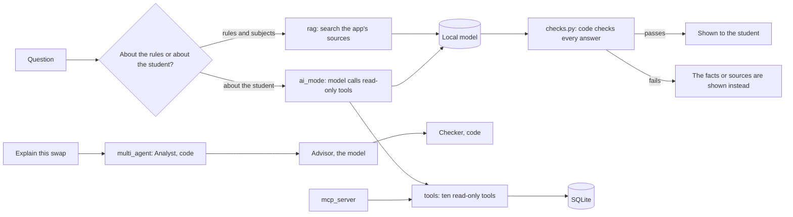

# Architecture overview

## The shape: a modular monolith
One Flask app serves every page. Each product feature is a folder under `features/` with the same layers inside it:

| File | Layer | Job |
|---|---|---|
| `routes.py` | web | Receives the request, checks the form and CSRF token, calls the service, renders a template |
| `service.py` | rules | The business rules. Plain functions on a database connection, so they are easy to test |
| `schema.sql`, `seed.py` | data | The feature's tables and its synthetic data |
| `templates/` | pages | What the student sees (server-rendered, with a little HTMX) |

There is no separate front-end project: the pages are rendered by the same app, so each feature keeps its pages and its logic together.
`shared/` holds what every feature needs (database connection, security helpers, the base page and styles).

All features share **one SQLite file**. That is deliberate. Swapping a major, completing or rolling back a semester, and recording a result
each change several tables (enrolments, attempts, plans, class choices, the student) and must happen all-or-nothing. One database makes
each of those a single transaction.

## Server-rendered pages, plus React and TypeScript where it helps
Most pages are server-rendered (Flask and Jinja). They work without JavaScript, the server enforces every rule, and the forms are easy to
secure and test. The **dashboard** is different: it is a visual summary (progress bars, a projection, a timeline), so it is built as a
**React and TypeScript "island"** inside one server-rendered page, in `frontend/`.

- **The server decides, React displays.** The page loads one read-only JSON endpoint (`GET /api/dashboard`) built from the same services as the
  other pages. It adds no rules of its own, and it cannot change anything.
- **A typed contract.** The shape of that JSON is described once in TypeScript (`frontend/src/contract.ts`, strict, validated with zod at runtime)
  and once by the server. Checked-in fixtures made from the real server data are validated by the front end's tests, and a Python test fails if
  the server stops matching them, so neither side can drift alone.
- **It still works without Node or JavaScript.** The built files are committed to `shared/static/dist`, so `python app.py` never needs Node, and the
  page contains a plain server-rendered summary that shows first and when scripts are off. CI rebuilds the bundle and fails if the committed one differs.
- **It looks native.** It uses the site's colour tokens only, so it follows light and dark mode, and a test fails if a colour is hard-coded.
- **Safe by construction.** The content security policy is unchanged (no inline scripts), links in the data must stay on this site, React escapes all text,
  dependencies are pinned to exact versions from a lock file, and CI runs `npm audit`, CodeQL and Dependabot.

## The AI helpers

- **The code decides, the AI explains.** Prerequisites, workload, swap verdicts and the confirmation tick are rules in code with tests.
- **Every AI answer is checked in code** (real citations, numbers only from the facts, no links, no claim of an action, no repeated instructions) before it is shown.
- **The tools are read-only and the student is chosen by the server**, never by the model, and the MCP server reads a snapshot it cannot write back.
- **AI mode is off by default** and the model runs on the student's own computer.

## How the plan changed
| | The plan | What was built | Why |
|---|---|---|---|
| Architecture | Microservice-style: each feature split into `frontend/`, `backend/`, `database/` and its own tests | One Flask app, one SQLite file, one folder per feature, tests mirroring it | Swaps, rollbacks and results are all-or-nothing changes across features, and one app is simpler to test and run |
| AI | Separate `rag-server`, `ai-mode`, `mcp-server` and `multi-agent-server` folders | The same four, as packages under `ai_services/`, sharing one tool layer, one model adapter and one set of checks | They all need the same read-only tools and the same checks, so sharing them keeps the safety rules in one place |
| Front end | React and TypeScript front end for the whole app | Server-rendered pages, with one React and TypeScript island (the dashboard) | A rewrite would have put the rule-heavy, tested pages at risk; one island shows the skill where a visual interface helps, behind a typed contract |
| Releases | R0 core, R1 RAG, MCP and AI mode, R2 multi-agent | All three delivered | The multi-agent swap advisor was kept to code roles plus one model role, so it can be tested |
