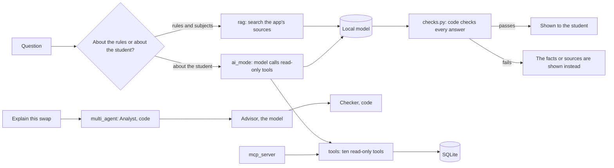

# Architecture overview

## The shape: a modular monolith
One Flask app serves every page. Each product feature is a folder under `features/` with the same layers inside it:

| File | Layer | Job |
|---|---|---|
| `routes.py` | web | Receives the request, checks the form and CSRF token, calls the service, renders a template |
| `service.py` | rules | The business rules. Plain functions on a database connection, so they are easy to test |
| `schema.sql`, `seed.py` | data | The feature's tables and its synthetic data |
| `templates/` | pages | What the student sees (server-rendered, with a little HTMX) |

There is no separate front-end project: the pages are rendered by the same app, so each feature keeps its pages and its logic together.
`shared/` holds what every feature needs (database connection, security helpers, the base page and styles).

All features share **one SQLite file**. That is deliberate. Swapping a major, completing or rolling back a semester, and recording a result
each change several tables (enrolments, attempts, plans, class choices, the student) and must happen all-or-nothing. One database makes
each of those a single transaction.

## The AI helpers

- **The code decides, the AI explains.** Prerequisites, workload, swap verdicts and the confirmation tick are rules in code with tests.
- **Every AI answer is checked in code** (real citations, numbers only from the facts, no links, no claim of an action, no repeated instructions) before it is shown.
- **The tools are read-only and the student is chosen by the server**, never by the model, and the MCP server reads a snapshot it cannot write back.
- **AI mode is off by default** and the model runs on the student's own computer.

## How the plan changed
| | The plan | What was built | Why |
|---|---|---|---|
| Architecture | Microservice-style: each feature split into `frontend/`, `backend/`, `database/` and its own tests | One Flask app, one SQLite file, one folder per feature, tests mirroring it | Swaps, rollbacks and results are all-or-nothing changes across features, and one app is simpler to test and run |
| AI | Separate `rag-server`, `ai-mode`, `mcp-server` and `multi-agent-server` folders | The same four, as packages under `ai_services/`, sharing one tool layer, one model adapter and one set of checks | They all need the same read-only tools and the same checks, so sharing them keeps the safety rules in one place |
| Releases | R0 core, R1 RAG, MCP and AI mode, R2 multi-agent | All three delivered | The multi-agent swap advisor was kept to code roles plus one model role, so it can be tested |
